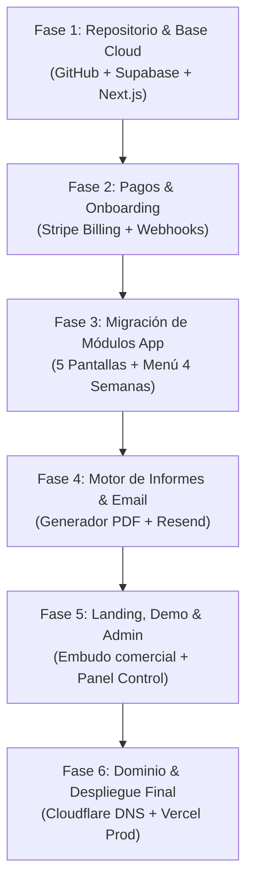

# 🚀 PLAN DIRECTOR DE TRANSFORMACIÓN SAAS: METAVITAL
## De Prototipo Local a Plataforma SaaS Multiusuario en Producción

> **Proyecto:** METAVITAL — Plataforma de Gestión y Control Integral de la Salud  
> **Arquitectura:** Next.js (Frontend/API) + Supabase (BaaS/PostgreSQL/RLS) + Stripe Billing + Vercel + Cloudflare + GitHub  
> **Ubicación:** `docs/PLAN_SAAS_METAVITAL.md`  
> **Fecha:** Octubre 2026  
> **Estado:** Aprobado para Ejecución  

---

## 📑 ÍNDICE GENERAL

1. [Visión General y Objetivos de Negocio](#1-visión-general-y-objetivos-de-negocio)
2. [Arquitectura Tecnológica Cloud](#2-arquitectura-tecnológica-cloud)
3. [Configuración de Infraestructura y Servicios Base](#3-configuración-de-infraestructura-y-servicios-base)
   - 3.1. Repositorio y CI/CD en GitHub
   - 3.2. Backend y Base de Datos en Supabase (PostgreSQL + RLS)
   - 3.3. Despliegue y Edge Runtime en Vercel
   - 3.4. Dominio, Seguridad y DNS en Cloudflare
   - 3.5. Pasarela de Pagos y Facturación en Stripe Billing
   - 3.6. Correo Transaccional Médico en Resend
4. [Diseño del Modelo de Datos (PostgreSQL & RLS)](#4-diseño-del-modelo-de-datos-postgresql--rls)
5. [Módulos Funcionales del Sistema](#5-módulos-funcionales-del-sistema)
   - 5.1. Embudo Comercial: Landing Page y Modo Demo Interactivo
   - 5.2. Pasarela de Pago, Webhooks y Onboarding Automatizado
   - 5.3. Portal del Paciente (PWA / SPA)
   - 5.4. Motor Clínico, Nutrición 4 Semanas y Compilador de Informes PDF
   - 5.5. Panel de Superadministrador (Control Central & Métricas SaaS)
6. [Cumplimiento Normativo y Protección de Datos (RGPD / HIPAA)](#6-cumplimiento-normativo-y-protección-de-datos-rgpd--hipaa)
7. [Hoja de Ruta de Implementación por Fases (Roadmap)](#7-hoja-de-ruta-de-implementación-por-fases-roadmap)
8. [Checklist Operativo de Lanzamiento](#8-checklist-operativo-de-lanzamiento)

---

## 1. VISIÓN GENERAL Y OBJETIVOS DE NEGOCIO

METAVITAL pasa de ser una aplicación web monofila local (`metavital_app.html`) a convertirse en un **Software as a Service (SaaS) B2C/B2B** de suscripción anual recurrente, especializado en la monitorización y mejora proactiva de la salud metabólica, renal y cardiovascular de sus usuarios.

### Objetivos Clave:
* **Escalabilidad Multiusuario:** Cada paciente dispone de su propio entorno privado y seguro, totalmente aislado de los demás usuarios.
* **Monetización Recurrente Automatizada:** Cobro anual mediante Stripe con alta inmediata, facturación electrónica y gestión autónoma del ciclo de vida de la suscripción.
* **Preservación de la Experiencia de Usuario:** Mantener la estética limpia y adaptada a móvil (los 4 botones de toma rápida, la navegación inferior de 5 pantallas, el menú terapéutico rotativo de 4 semanas y el auditor de ingesta diaria).
* **Seguridad y Confianza Clínica:** Cumplimiento riguroso del Reglamento General de Protección de Datos (RGPD) para datos de salud de categoría especial (Art. 9 RGPD).

---

## 2. ARQUITECTURA TECNOLÓGICA CLOUD

```
                   [ USUARIO / NAVEGADOR / MÓVIL ]
                                  │
                                  ▼
                [ CLOUDFLARE: DNS, WAF, SSL, CACHE ]
                    (Dominio: metavital.es / app)
                                  │
                                  ▼
                 [ VERCEL: Hosting & Next.js SSR/Edge ]
             ┌────────────────────┴────────────────────┐
             ▼                                         ▼
   [ Landing Page Pública ]                  [ App Privada Autenticada ]
   - Modo Demo Interactivo                   - Pantalla 1: Hoy (4 tomas)
   - Pricing y Checkout Stripe               - Pantalla 2: Semana & Fármacos
                                             - Pantalla 3: Parámetros Clínicos
                                             - Pantalla 4: Menú 4 Semanas
                                             - Pantalla 5: Deporte & Médico
             │                                         │
             ▼                                         ▼
   [ STRIPE BILLING API ]                    [ SUPABASE POSTGRESQL ]
   - Checkout Anual recurrente               - Auth (JWT / Magic Link)
   - Webhooks a /api/webhooks/stripe         - Row Level Security (RLS)
   - Customer Portal de Facturas             - Storage (PDFs médicos)
                                                       │
                                                       ▼
                                            [ RESEND / WHATSAPP ]
                                            - Envío Informe Mensual
```

### Componentes de la Pila Tecnológica:
| Capa | Tecnología | Función Principal |
| :--- | :--- | :--- |
| **Control de Versiones** | **GitHub** | Repositorio git centralizado, protección de ramas `main`, CI/CD automático |
| **Frontend / PWA** | **Next.js 14+ (App Router)** | Renderizado híbrido (SSR + SPA), TypeScript, soporte offline y TailwindCSS |
| **Backend as a Service** | **Supabase** | PostgreSQL administrado, Supabase Auth, Row Level Security, Edge Functions |
| **Hosting & Computación** | **Vercel** | Despliegues automáticos por commit, Serverless API Routes, CDN global |
| **Dominio y Red Perimetral** | **Cloudflare** | Gestión DNS, SSL/TLS Full Strict, WAF, mitigación anti-DDoS, optimización HTTP/3 |
| **Pagos y Facturación** | **Stripe Billing** | Checkout seguro, cobro recurrente anual, portal de autoservicio de facturación |
| **Correo Transaccional** | **Resend** | Notificaciones de cuenta, enlaces de acceso seguro y remisión del informe al médico |
| **Generación de Informes** | **@react-pdf / Puppeteer** | Compilación de informe clínico mensual de alta fidelidad diagnóstica |

---

## 3. CONFIGURACIÓN DE INFRAESTRUCTURA Y SERVICIOS BASE

### 3.1. Repositorio y CI/CD en GitHub
1. **Estructura del Repositorio:**
   * `/src/app`: Rutas públicas (Landing, Demo) y privadas (`/app/*`, `/admin/*`).
   * `/src/components`: Componentes atómicos (Botones biométricos, acordeones de menú, auditor dietético).
   * `/src/lib`: Clientes de Supabase, Stripe y utilidades clínicas.
   * `/supabase`: Migraciones SQL, políticas RLS y funciones de base de datos.
2. **Estrategia de Ramas:**
   * `main`: Producción (despliegue automático a Vercel Producción con dominio oficial).
   * `staging` o PRs: Entornos de vista previa (*Vercel Preview Deployments*).

### 3.2. Backend y Base de Datos en Supabase
1. **Creación del Proyecto Supabase:**
   * Organización en la región UE (Fráncfort o Madrid) para cumplir RGPD y minimizar latencia.
2. **Autenticación (Supabase Auth):**
   * Proveedores: Correo electrónico + Contraseña, Enlace mágico (Magic Link) sin contraseña.
   * Sincronización automática de usuarios registrados con la tabla pública `public.profiles` mediante *Trigger* de PostgreSQL.
3. **Seguridad RLS (Row Level Security):**
   * Activación estricta de RLS en todas las tablas. Cada paciente solo puede consultar, insertar y actualizar sus propios registros (`auth.uid() = user_id`).

### 3.3. Despliegue y Edge Runtime en Vercel
1. Conexión del repositorio GitHub con el proyecto Vercel.
2. Variables de Entorno Seguras:
   * `NEXT_PUBLIC_SUPABASE_URL`
   * `NEXT_PUBLIC_SUPABASE_ANON_KEY`
   * `SUPABASE_SERVICE_ROLE_KEY` (solo servidor)
   * `STRIPE_SECRET_KEY`
   * `STRIPE_WEBHOOK_SECRET`
   * `NEXT_PUBLIC_STRIPE_PUBLISHABLE_KEY`
   * `RESEND_API_KEY`

### 3.4. Dominio, Seguridad y DNS en Cloudflare
1. **Configuración de Zona DNS en Cloudflare:**
   * Registro `CNAME` `@` (apex) apuntando a `cname.vercel-dns.com` (con proxy naranja activo).
   * Registro `CNAME` `app` apuntando a `cname.vercel-dns.com`.
   * Registros `TXT` para verificación de dominio y SPF/DKIM para el envío de correos desde Resend.
2. **Seguridad Cloudflare:**
   * Modo SSL/TLS: **Full (Strict)**.
   * Redirección automática siempre a **HTTPS**.
   * Reglas de firewall de Cloudflare (WAF) para bloquear ataques de fuerza bruta y bots sospechosos.

### 3.5. Pasarela de Pagos y Facturación en Stripe Billing
1. **Creación de Producto y Precios:**
   * Producto: *MetaVital Plan Anual Salud*.
   * Modelo: Suscripción anual recurrente (ej. 149 €/año o 180 €/año).
2. **Checkout Session:**
   * Redirección al formulario alojado por Stripe (máxima seguridad PCI-DSS compliance).
   * Recogida de NIF/CIF opcional para emisión automática de facturas con desglose de IVA español.
3. **Webhook de Stripe:**
   * Endpoint en Vercel: `/api/webhooks/stripe`.
   * Eventos procesados:
     * `checkout.session.completed`: Asocia el `stripe_customer_id` y `subscription_id` al usuario de Supabase y activa su acceso.
     * `customer.subscription.updated`: Modifica el estado si se suspende o renueva.
     * `customer.subscription.deleted`: Bloquea el acceso del usuario en caso de cancelación o impago continuado.
4. **Stripe Customer Portal:**
   * El paciente accede a su portal privado de Stripe con 1 clic para descargar sus facturas oficiales en PDF o actualizar su tarjeta de crédito.

### 3.6. Correo Transaccional Médico en Resend
* Envío de confirmación de suscripción y bienvenida.
* **Envío Seguro del Informe Mensual al Médico:**
  * En lugar de adjuntar un PDF sin cifrar por correo abierto, se envía un email formal con un **enlace temporal firmado (con caducidad de 7 días)** y código PIN de acceso, garantizando confidencialidad médica.

---

## 4. DISEÑO DEL MODELO DE DATOS (POSTGRESQL & RLS)

```sql
-- 1. EXTENSIÓN UUID
CREATE EXTENSION IF NOT EXISTS "uuid-ossp";

-- 2. TABLA DE PERFILES (Vinculada a auth.users de Supabase)
CREATE TABLE public.profiles (
    id UUID PRIMARY KEY REFERENCES auth.users(id) ON DELETE CASCADE,
    full_name TEXT NOT NULL,
    birth_date DATE,
    height_cm NUMERIC(5,2),
    assigned_doctor_name TEXT,
    assigned_doctor_phone TEXT,
    assigned_doctor_email TEXT,
    assigned_center TEXT,
    medical_notes TEXT,
    subscription_status TEXT DEFAULT 'inactive' CHECK (subscription_status IN ('inactive', 'active', 'past_due', 'trial', 'cancelled')),
    stripe_customer_id TEXT UNIQUE,
    stripe_subscription_id TEXT UNIQUE,
    created_at TIMESTAMPTZ DEFAULT NOW(),
    updated_at TIMESTAMPTZ DEFAULT NOW()
);

-- 3. TABLA DE MEDICIONES BIOMÉTRICAS (Toma Diaria: Glucemia, Tensión, Peso, Pasos)
CREATE TABLE public.biometric_readings (
    id UUID PRIMARY KEY DEFAULT uuid_generate_v4(),
    user_id UUID NOT NULL REFERENCES public.profiles(id) ON DELETE CASCADE,
    metric_type TEXT NOT NULL CHECK (metric_type IN ('GLUCOSE', 'BP', 'WEIGHT', 'STEPS')),
    val_primary NUMERIC(7,2) NOT NULL, -- Glucosa (mg/dL), Sistólica (mmHg), Peso (kg), Pasos
    val_secondary NUMERIC(7,2),         -- Diastólica (mmHg) para BP
    val_tertiary NUMERIC(7,2),          -- Pulso (lpm)
    notes TEXT,
    device_source TEXT DEFAULT 'manual', -- 'manual', 'camera_ocr', 'bluetooth'
    measured_at TIMESTAMPTZ DEFAULT NOW(),
    created_at TIMESTAMPTZ DEFAULT NOW()
);

-- 4. TABLA DE PAUTAS DE MEDICACIÓN Y ADHERENCIA DIARIA
CREATE TABLE public.medication_prescriptions (
    id UUID PRIMARY KEY DEFAULT uuid_generate_v4(),
    user_id UUID NOT NULL REFERENCES public.profiles(id) ON DELETE CASCADE,
    drug_name TEXT NOT NULL,
    active_ingredient TEXT,
    dosage TEXT NOT NULL,
    schedule_time TIME NOT NULL,
    timing_label TEXT NOT NULL, -- 'Desayuno', 'Comida', 'Cena', 'Noche'
    is_active BOOLEAN DEFAULT TRUE,
    clinical_purpose TEXT
);

CREATE TABLE public.medication_logs (
    id UUID PRIMARY KEY DEFAULT uuid_generate_v4(),
    user_id UUID NOT NULL REFERENCES public.profiles(id) ON DELETE CASCADE,
    prescription_id UUID REFERENCES public.medication_prescriptions(id) ON DELETE CASCADE,
    taken_at TIMESTAMPTZ DEFAULT NOW(),
    date_logged DATE DEFAULT CURRENT_DATE,
    status TEXT DEFAULT 'taken' CHECK (status IN ('taken', 'skipped', 'delayed'))
);

-- 5. TABLA DE REGISTRO DIARIO DE INGESTA REAL Y EVALUADOR NUTRICIONAL
CREATE TABLE public.daily_food_logs (
    id UUID PRIMARY KEY DEFAULT uuid_generate_v4(),
    user_id UUID NOT NULL REFERENCES public.profiles(id) ON DELETE CASCADE,
    log_date DATE NOT NULL,
    day_name TEXT NOT NULL, -- 'lunes', 'martes', etc.
    desayuno_text TEXT,
    comida_text TEXT,
    cena_text TEXT,
    audit_status TEXT CHECK (audit_status IN ('green', 'yellow', 'red')),
    audit_score INTEGER,
    audit_feedback JSONB, -- Puntos positivos, alertas de potasio, sodio, azúcares
    created_at TIMESTAMPTZ DEFAULT NOW(),
    UNIQUE (user_id, log_date)
);

-- 6. TABLA DE INFORMES MÉDICOS GENERADOS
CREATE TABLE public.monthly_reports (
    id UUID PRIMARY KEY DEFAULT uuid_generate_v4(),
    user_id UUID NOT NULL REFERENCES public.profiles(id) ON DELETE CASCADE,
    period_month INTEGER NOT NULL,
    period_year INTEGER NOT NULL,
    storage_path TEXT NOT NULL, -- Ruta en Supabase Storage
    download_token UUID DEFAULT uuid_generate_v4(),
    token_expires_at TIMESTAMPTZ,
    sent_to_doctor_at TIMESTAMPTZ,
    doctor_email_sent TEXT,
    created_at TIMESTAMPTZ DEFAULT NOW()
);

-- ========================================================
-- POLÍTICAS DE SEGURIDAD POR FILA (ROW LEVEL SECURITY - RLS)
-- ========================================================

ALTER TABLE public.profiles ENABLE ROW LEVEL SECURITY;
ALTER TABLE public.biometric_readings ENABLE ROW LEVEL SECURITY;
ALTER TABLE public.medication_prescriptions ENABLE ROW LEVEL SECURITY;
ALTER TABLE public.medication_logs ENABLE ROW LEVEL SECURITY;
ALTER TABLE public.daily_food_logs ENABLE ROW LEVEL SECURITY;
ALTER TABLE public.monthly_reports ENABLE ROW LEVEL SECURITY;

-- Regla: El usuario solo lee y edita sus propios datos
CREATE POLICY "Users can view own profile" ON public.profiles
    FOR SELECT USING (auth.uid() = id);

CREATE POLICY "Users can update own profile" ON public.profiles
    FOR UPDATE USING (auth.uid() = id);

CREATE POLICY "Users manage own biometrics" ON public.biometric_readings
    FOR ALL USING (auth.uid() = user_id);

CREATE POLICY "Users manage own food logs" ON public.daily_food_logs
    FOR ALL USING (auth.uid() = user_id);

CREATE POLICY "Users manage own medications" ON public.medication_prescriptions
    FOR ALL USING (auth.uid() = user_id);

CREATE POLICY "Users manage own medication logs" ON public.medication_logs
    FOR ALL USING (auth.uid() = user_id);

CREATE POLICY "Users view own reports" ON public.monthly_reports
    FOR SELECT USING (auth.uid() = user_id);
```

---

## 5. MÓDULOS FUNCIONALES DEL SISTEMA

### 5.1. Embudo Comercial: Landing Page y Modo Demo Interactivo
1. **Landing Page Pública (`/`):**
   * **Propuesta de Valor:** "El control médico y nutricional que tu salud necesita, en una sola plataforma".
   * **Visualización de Interfaz:** Capturas y carrusel de la experiencia móvil (los 4 biomarcadores diarios, el menú mensual de 4 semanas, la prescripción de caminata en llano y el informe automatizado para el médico).
   * **Tabla de Precios:** Presentación clara de la cuota anual (ej. pago único anual con ahorro frente a mensualidades).
   * **Botones de Llamada a la Acción (CTA):** "Suscribirme Ahora" (lleva a Stripe Checkout) y "Probar Demo Interactiva".
2. **Modo Demo Interactivo (`/demo`):**
   * Permite probar todas las pantallas con un perfil preconfigurado ("Paciente de Demostración").
   * **Persistencia Volátil:** Las modificaciones se guardan en el estado local de memoria o `sessionStorage` y se resetean al recargar, sin escribir en la base de datos de producción.

### 5.2. Pasarela de Pago, Webhooks y Onboarding Automatizado
```
[Landing / Precios] 
       │ 
       ▼ (Click en Suscribirme)
[Stripe Checkout Session] ── (Pago Exitoso) ──► [Webhook /api/webhooks/stripe]
                                                        │
                                                        ▼
                                           [Crea Usuario en Supabase]
                                                        │
                                                        ▼
                                           [Email de Bienvenida con Set-Password]
                                                        │
                                                        ▼
                                           [Redirección a /app (Dashboard)]
```

### 5.3. Portal del Paciente (PWA / SPA)
El diseño del portal del paciente conserva la arquitectura de **5 pantallas** perfeccionada en el prototipo:
1. **☀️ Hoy (Toma Diaria):**
   * Encabezado limpio con logo oficial y lema general: *Control Integral de Tu Salud*.
   * Ficha de paciente resumida con estado general y dianas terapéuticas.
   * **Las 4 Tomas Diarias Principales:**
     1. 🩸 **GLUCÓMETRO** (Glucosa basal)
     2. 💓 **TENSIÓMETRO** (Presión arterial y pulso)
     3. ⚖️ **BÁSCULA** (Peso corporal e IMC)
     4. 👟 **PODÓMETRO** (Pasos andados en terreno llano)
2. **📅 Semana & Medicación:**
   * Balance de Evolución Global del Estado de Salud (`🟢 EVOLUCIÓN POSITIVA`).
   * Comparativa temporal en 3 hitos (Inicio ➡️ Hace 15 Días ➡️ Hoy).
   * Pautas farmacológicas diarias con casillas de verificación de tomas tomadas/pendientes.
3. **🩺 Parámetros Clínicos:**
   * Visualización de analíticas (Filtrado renal FG 42, Potasio 5.5, Triglicéridos 346, etc.).
   * Estado y medidas de corrección clínica para cada desviación.
4. **🥗 Nutrición & Compra:**
   * **Mi Ingesta Real del Día:** Registro interactivo de Desayuno, Comida y Cena con Auditor Clínico que alerta de potasio, sodio y azúcares.
   * **Menú Mensual Terapéutico Rotativo (4 Semanas / 28 Días):** Selector de Semana 1 a 4 y selector de Lunes a Domingo en formato compacto.
   * **Lista de la Compra Mensual Adaptada:** Organizada por pasillos de supermercado y plegable para no saturar espacio.
5. **👟 Actividad & Médico de Cabecera:**
   * Prescripción de ejercicio: *Caminar en terreno llano* y sus 3 efectos médicos.
   * Podómetro y progreso de actividad física.
   * Datos del Médico de Cabecera y botón de envío del Informe Mensual por WhatsApp y Correo electrónico.

### 5.4. Motor Clínico y Compilador de Informes PDF
* Compilación mensual desatendida: el día 1 de cada mes se genera automáticamente el informe clínico consolidado del mes anterior.
* El informe incluye:
  * Gráficas de evolución de glucosa, tensión, peso y pasos.
  * Porcentaje de adherencia terapéutica a los fármacos.
  * Resumen del cumplimiento dietético y actividad física.
  * Observaciones automáticas de seguridad (ej. protocolo renal: cero AINEs, control de potasio).

### 5.5. Panel de Superadministrador (`/admin`)
Panel privado protegido reservado para el administrador del SaaS:
1. **Métricas Clave de Negocio (SaaS KPIs):**
   * **ARR (Ingresos Anuales Recurrentes)** y **MRR (Ingresos Mensuales Equivalentes)**.
   * Número de usuarios activos, altas del mes y cancelaciones (Churn Rate).
2. **Gestión de Pacientes:**
   * Listado de usuarios registrados con estado de suscripción en Stripe (Activo, Impago, Cancelado).
   * Visualización en modo soporte (impersonación de lectura) para asistir a un usuario con incidencias técnicas.
3. **Gestor de Contenido Clínico:**
   * Editor de plantillas de dietas para añadir nuevas semanas o modificar recetas e ingredientes recomendados.

---

## 6. CUMPLIMIENTO NORMATIVO Y PROTECCIÓN DE DATOS (RGPD / HIPAA)

El tratamiento de métricas biomédicas exige el máximo nivel de rigor normativo bajo la legislación europea:

| Requisito Legal | Implementación Técnica en METAVITAL |
| :--- | :--- |
| **Categoría Especial de Datos (Art. 9 RGPD)** | Consentimiento explícito obligatorio en el formulario de alta (*checkbox* sin premarcar específico para datos médicos). |
| **Aislamiento de Información (Multi-tenancy)** | Supabase PostgreSQL con **Row Level Security (RLS)** estricto. La consulta de un usuario no puede resolver datos de otro bajo ninguna circunstancia. |
| **Cifrado Integral** | Cifrado en tránsito forzado vía **TLS 1.3 / HTTPS** por Cloudflare y Vercel. Cifrado en reposo (**AES-256**) nativo en Supabase. |
| **Envío Seguro de Informes a Facultativos** | No se remiten historiales completos en archivos abiertos por correo ordinario. Se utiliza enlace temporal cifrado con caducidad (7 días) y verificación previa. |
| **Derechos ARCO (Acceso, Supresión, Portabilidad)** | Botón de exportación de todos los datos en formato JSON/PDF y procedimiento automático de baja y eliminación definitiva de la cuenta. |

---

## 7. HOJA DE RUTA DE IMPLEMENTACIÓN POR FASES (ROADMAP)



### Detalle de Fases de Ejecución:

#### 🟢 FASE 1: Configuración de Infraestructura y Repositorio Base
* Crear el repositorio oficial en **GitHub** con control de ramas.
* Inicializar el proyecto **Next.js 14+** (App Router, TypeScript, TailwindCSS).
* Desplegar el proyecto base en **Vercel** vinculado a la rama `main`.
* Crear el proyecto en **Supabase** y ejecutar el script SQL con las tablas `profiles`, `biometric_readings`, `medications`, `daily_food_logs` y sus políticas RLS.
* Configurar Supabase Auth (Login, Registro, Recuperación de contraseña).

#### 🟢 FASE 2: Pasarela de Pago (Stripe Billing) y Onboarding
* Configurar cuenta de Stripe y crear el producto de suscripción anual.
* Crear endpoint de creación de Checkout Session en `/api/checkout`.
* Implementar el manejador de webhooks en `/api/webhooks/stripe` para la creación y activación automática de usuarios en Supabase tras el cobro exitoso.
* Configurar redirección a `/app/onboarding` para completar perfil médico y contraseña.

#### 🟢 FASE 3: Migración Integral de la Aplicación del Paciente
* Integrar la arquitectura de 5 pantallas en Next.js conservando la estética exacta:
  * **Pantalla 1:** Tomas rápidas de Glucómetro, Tensiómetro, Báscula y **Podómetro**.
  * **Pantalla 2:** Balance de evolución global y checklist de fármacos.
  * **Pantalla 3:** Visualización de analíticas y parámetros corregibles.
  * **Pantalla 4:** Menú mensual terapéutico de **4 semanas (28 días)** + Diario de ingesta real con auditor automático + Lista de la compra plegable.
  * **Pantalla 5:** Actividad física y prescripción de caminata en llano + Ficha médica de cabecera.

#### 🟢 FASE 4: Informes Clínicos Automatizados y Notificaciones
* Diseñar la plantilla de informe mensual en PDF de alta fidelidad diagnóstica.
* Integrar generación de informe bajo demanda o programada el día 1 de cada mes.
* Configurar **Resend** para el despacho de correos transaccionales y notificación al facultativo con enlace seguro de descarga.
* Conexión con la API de WhatsApp Web para el envío rápido de informe al médico.

#### 🟢 FASE 5: Embudo Comercial, Modo Demo y Panel de Superadministrador
* Desarrollar la **Landing Page** de venta con propuesta de valor, capturas de pantalla, testimonios y tabla de precios con botón directo a Stripe.
* Implementar el **Modo Demo Interactivo** (`/demo`) con datos clínicos ficticios precargados y persistencia en memoria local.
* Construir el **Panel de Superadministrador** (`/admin`) con métricas ARR, estado de suscripciones y herramienta de soporte a clientes.

#### 🟢 FASE 6: Configuración de Dominio Oficial, DNS y Auditoría de Seguridad
* Conectar el dominio personalizado desde **Cloudflare** hacia **Vercel**.
* Habilitar SSL Full (Strict), HTTP/3 y protección WAF en Cloudflare.
* Auditoría de seguridad: comprobación de aislamiento RLS de Supabase, validación de webhooks con firma criptográfica de Stripe y verificación RGPD de formularios.
* Puesta en marcha oficial en producción.

---

## 8. CHECKLIST OPERATIVO DE LANZAMIENTO

- [ ] **GitHub:** Repositorio creado, secretos configurados (`VERCEL_TOKEN`, etc.) y rama `main` protegida.
- [ ] **Supabase:** Tablas creadas, índices optimizados y RLS verificado para cada tabla.
- [ ] **Vercel:** Despliegue en producción completado, variables de entorno validadas.
- [ ] **Stripe:** Producto anual creado en modo *Live*, webhook configurado y probado en producción, Customer Portal habilitado.
- [ ] **Cloudflare:** Registros DNS apuntando a Vercel, SSL/TLS en modo *Full Strict*, WAF activo.
- [ ] **Resend:** Dominio remitente verificado mediante registros DNS (SPF, DKIM, DMARC).
- [ ] **Landing Page:** Textos de venta pulidos, botón de suscripción operativo y modo Demo navegable.
- [ ] **RGPD:** Términos y condiciones, política de privacidad y consentimiento explícito de salud implementados.

---

*Documento redactado y validado para su ejecución directa en el espacio de trabajo de METAVITAL.*

